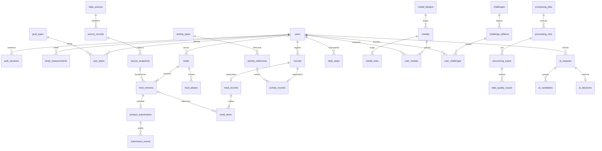

# FitIn — proposta funcional de banco de dados

Status: esquema lógico de referência. As 38 migrações iniciais foram implementadas e verificadas em MySQL 8.4 local; configuração, diferenças e limites em `docs/database-setup.md`. Endpoints de negócio e integração do frontend continuam pendentes.

## 1. Arquitetura e escopo

Backend Node.js/TypeScript organizado em módulos; MySQL 8.4 LTS, InnoDB, `utf8mb4`. Um banco e uma aplicação inicialmente. Acesso ao MySQL apenas pelo backend. Não criar microsserviços, data warehouse ou banco vetorial nesta entrega.

Domínios: identidade; avaliação corporal; planejamento; catálogo nutricional; diário; atividades; conquistas; integração e qualidade de dados.

A modelagem cobre a operação atual: cadastro/login/recuperação; perfil; medidas; quatro planos; alimentos próprios e referências externas; refeições manuais ou do catálogo; atividade manual, de dispositivo ou estimada; passos; desafios e medalhas. A proposta não pressupõe integração já autorizada com TBCA. TACO, Open Food Facts e USDA mantêm suas respectivas procedências e condições de uso.

Fases:

- **A — operação:** tabelas 1–12 e 16–30; preencher catálogos por seeds e integrar os fluxos atuais. Importar os produtos locais somente após o usuário entrar na conta real correspondente.
- **B — tratamento:** tabelas 13–15 e 31–35; revisão, ingestão assíncrona e observabilidade. Criar o outbox junto à primeira operação que precisar publicar trabalho assíncrono.
- **C — IA:** tabelas 36–38; adicionar quando existir um caso de uso concreto. A estrutura não depende delas para funcionar.
- Agregados analíticos são uma projeção futura, não uma segunda fonte de verdade.

## 2. Convenções que fazem parte de todas as tabelas

Esta seção e as listas abaixo compõem o esquema lógico completo proposto. O DDL inicial está em `backend/migrations/` e os testes de integração do banco em `backend/test/`. Esta especificação lógica continua sujeita à revisão; regras que dependem de serviços ainda serão implementadas.

- `ID` = `BIGINT UNSIGNED`; PK `id` usa `AUTO_INCREMENT`, salvo PK expressamente indicada. IDs são internos; não substituem autorização. O backend serializa BIGINT como string no JSON para não perder precisão em JavaScript.
- `DT` = `DATETIME(6)` em UTC. Toda tabela tem `created_at DT NOT NULL DEFAULT CURRENT_TIMESTAMP(6)`. Tabelas marcadas **mutável** também têm `updated_at DT NOT NULL DEFAULT CURRENT_TIMESTAMP(6)`, atualizado em toda alteração.
- `NN` = `NOT NULL`; `?` = coluna permite `NULL`. Sem `?`, a coluna é NN. Colunas opcionais têm default NULL; outros defaults são explicitados. `FK → tabela.coluna` descreve a chave estrangeira exata.
- `D` = `DECIMAL(12,4)`; energia, massa, volume, macros e resultados quantitativos não usam FLOAT. Uma coluna de valor nutricional desconhecido é NULL; zero significa zero informado.
- Texto usa `utf8mb4_0900_ai_ci` por padrão. Códigos, hashes e identificadores externos usam collation binária ou tipo binário. Não comparar e-mails através da collation geral: usar a coluna normalizada.
- Todos os BOOLEAN têm `CHECK (coluna IN (0,1))`. Todos os valores quantitativos opcionais têm `CHECK (coluna IS NULL OR coluna >= 0)`, além de restrições específicas indicadas.
- Listas de estados são `VARCHAR` com CHECK dos valores enumerados neste documento. Não usar ENUM para estados que evoluem.
- Toda FK usa `ON UPDATE RESTRICT ON DELETE RESTRICT`, salvo indicação explícita. Não apagar catálogos ou versões referenciadas. Expiração de sessões e tokens permite remoção física controlada. Exclusão de conta exige um fluxo próprio de eliminação/anonimização, inclusive derivados e backups conforme política definida; soft delete não equivale a eliminação.
- Criar índices explicitados e índices necessários às FKs. Não indexar indiscriminadamente todas as colunas.
- Tabelas de versões, eventos e snapshots são imutáveis para a aplicação; correções geram nova versão/evento. Permissões e backend garantem isso; CHECK não torna uma linha imutável.

## 3. Identidade e autenticação

### 1. users — mutável

Colunas: `id ID PK`; `email VARCHAR(254)`; `email_normalized VARCHAR(254)`; `password_hash VARCHAR(255)`; `display_name VARCHAR(100)`; `birth_date DATE ?`; `gender_identity VARCHAR(40) ?`; `calculation_sex VARCHAR(16) ?`; `timezone VARCHAR(64) DEFAULT 'America/Sao_Paulo'`; `locale VARCHAR(16) DEFAULT 'pt-BR'`; `character_code VARCHAR(32) DEFAULT 'blue'`; `status VARCHAR(16) DEFAULT 'active'`; `email_verified_at DT ?`; `deleted_at DT ?`; timestamps comuns.

Constraints: UNIQUE `email_normalized`; `calculation_sex` ∈ (`male`,`female`,`unspecified`) ou NULL; `status` ∈ (`active`,`disabled`,`deletion_pending`,`deleted`). `character_code` é chave de um catálogo de apresentação no código, não identidade corporal.

Backend: normalização documentada de e-mail sem regras inventadas de remoção de pontos; hash Argon2id; nascimento válido/não futuro; timezone IANA válido. Identidade de gênero e parâmetro exigido por fórmula são distintos. Não guardar idade calculada nem senha em texto puro.

### 2. auth_sessions — mutável

Colunas: `id ID PK`; `user_id ID FK → users.id`; `refresh_token_hash BINARY(32)`; `expires_at DT`; `revoked_at DT ?`; `last_used_at DT ?`; timestamps comuns.

Constraints: UNIQUE `refresh_token_hash`; `expires_at > created_at`. Índice `(user_id, revoked_at, expires_at)`. Cookie HttpOnly/Secure e proteção CSRF conforme arquitetura do cliente. Hash do token aleatório, nunca seu valor original. Rotação e revogação em transação.

### 3. account_tokens

Colunas: `id ID PK`; `user_id ID FK → users.id`; `purpose VARCHAR(24)`; `token_hash BINARY(32)`; `expires_at DT`; `used_at DT ?`; `created_at`.

Constraints: UNIQUE `token_hash`; `purpose` ∈ (`verify_email`,`reset_password`); `expires_at > created_at`. Índice `(user_id, purpose, expires_at)`. Consumo atômico uma única vez.

## 4. Avaliação corporal e planejamento

### 4. body_measurements — mutável

Colunas: `id ID PK`; `user_id ID FK → users.id`; `measured_at DT`; `local_date DATE`; `timezone VARCHAR(64)`; `weight_kg D ?`; `height_cm D ?`; `neck_cm D ?`; `waist_cm D ?`; `hip_cm D ?`; `origin VARCHAR(16) DEFAULT 'manual'`; `note VARCHAR(500) ?`; `row_version INT UNSIGNED DEFAULT 1`; `deleted_at DT ?`; timestamps comuns.

Constraints: UNIQUE `(id,user_id)` para referências que precisam conferir proprietário; ao menos uma medida não NULL; toda medida informada > 0; `row_version > 0`; `origin` ∈ (`manual`,`device`,`import`). Índice `(user_id, local_date, measured_at, id)`.

Permite várias medições no dia e preenchimento parcial. Backend escolhe a última medida conhecida de cada grandeza na data solicitada; não assume que uma medição parcial apagou as demais. Peso/altura não ficam duplicados em users. Alterações não recalculam atividades antigas. Dados anteriores à importação conservam sua data original.

### 5. goal_types

Colunas: `id ID PK`; `code VARCHAR(24)`; `name VARCHAR(60)`; `balance_direction SMALLINT`; `active BOOLEAN DEFAULT 1`; `created_at`.

Constraints: UNIQUE `code`; `balance_direction IN (-1,0,1)`. Seeds: `weight_loss`, `cutting`, `maintenance`, `lean_bulk`. Emagrecer e cutting compartilham a regra atual, com códigos próprios. Direção indica saldo de ingestão desejado, não uma cor.

### 6. user_plans — mutável apenas para encerramento de vigência

Colunas: `id ID PK`; `user_id ID FK → users.id`; `goal_type_id ID FK → goal_types.id`; `valid_from DATE`; `valid_until DATE ?`; `daily_target_kcal D`; `goal_weight_kg D ?`; `weekly_weight_change_kg DECIMAL(6,3) ?`; `habitual_activity_factor DECIMAL(5,3) ?`; `activity_credit_policy VARCHAR(24) DEFAULT 'logged_active'`; `origin VARCHAR(16)`; `calculation_method VARCHAR(64) ?`; `calculation_version VARCHAR(32) ?`; `calculation_inputs JSON ?`; `row_version INT UNSIGNED DEFAULT 1`; timestamps comuns.

Constraints: UNIQUE `(id,user_id)` e `(user_id,valid_from)`; `daily_target_kcal > 0`; `goal_weight_kg IS NULL OR goal_weight_kg > 0`; `weekly_weight_change_kg` pode ser negativo (perda), zero ou positivo (ganho); fator informado >= 1; `valid_until IS NULL OR valid_until > valid_from`; `origin` ∈ (`manual`,`calculated`); `activity_credit_policy` ∈ (`logged_active`,`included_in_target`). Índice `(user_id, valid_from, valid_until)`.

Vigência em intervalo [início,fim), fim exclusivo. MySQL não impede sobreposição de intervalos por CHECK: backend bloqueia a linha de users com SELECT FOR UPDATE, verifica intervalos, encerra o plano anterior e cria o novo na mesma transação. Nova meta gera nova linha. O backend valida o sinal da mudança semanal conforme o objetivo; não impõe emagrecimento a manutenção ou ganho. `calculation_inputs` guarda os valores realmente utilizados, inclusive dados corporais, sem depender de valores atuais de users.

O desenho torna explícito se o exercício já está incluído na meta. Inicialmente a demo usa crédito de calorias ativas registradas; antes de converter o cálculo da meta para produção, revisar o fator de atividade para evitar dupla contagem.

## 5. Fontes e catálogo nutricional

### 7. data_sources — mutável

Colunas: `id ID PK`; `code VARCHAR(32)`; `name VARCHAR(100)`; `kind VARCHAR(24)`; `base_url VARCHAR(1000) ?`; `terms_url VARCHAR(1000) ?`; `license_code VARCHAR(100) ?`; `license_notes TEXT ?`; `terms_checked_at DT ?`; `enabled BOOLEAN DEFAULT 1`; timestamps comuns.

Constraints: UNIQUE `code`; `kind` ∈ (`external_api`,`reference_dataset`,`personal_label`,`fitin_curated`). Seeds identificam TACO, OFF, USDA, rótulo pessoal e referência de MET. Não guardar chaves de APIs no banco de domínio; usar configuração segura do servidor.

### 8. source_records — mutável

Colunas: `id ID PK`; `source_id ID FK → data_sources.id`; `external_id VARCHAR(191)`; `source_url VARCHAR(1000) ?`; `first_seen_at DT`; `last_seen_at DT`; timestamps comuns.

Constraints: UNIQUE `(source_id,external_id)` com comparação binária. A identidade é local à fonte: ID do USDA não se confunde com ID do OFF. Esta tabela não declara que dois registros representam o mesmo produto.

### 9. source_snapshots

Colunas: `id ID PK`; `source_record_id ID FK → source_records.id`; `fetched_at DT`; `upstream_version VARCHAR(100) ?`; `payload_sha256 BINARY(32)`; `payload_json JSON ?`; `payload_object_key VARCHAR(500) ?`; `retention_until DT ?`; `created_at`.

Constraints: UNIQUE `(source_record_id,payload_sha256)`; exatamente uma localização original: `(payload_json IS NOT NULL) <> (payload_object_key IS NOT NULL)`. Índice `(source_record_id,fetched_at)`.

Guardar apenas dados cujo armazenamento seja permitido pela fonte. JSON atende cargas pequenas; volume maior vai para armazenamento de objetos com acesso controlado. `payload_object_key` é uma chave, não URL pública. Não copiar dados pessoais do usuário para payload externo. Conteúdo idêntico reutiliza o snapshot; última consulta fica em source_records.

### 10. foods — mutável

Colunas: `id ID PK`; `owner_user_id ID ? FK → users.id`; `visibility VARCHAR(16)`; `kind VARCHAR(24)`; `name VARCHAR(160)`; `brand VARCHAR(120) ?`; `barcode VARCHAR(14) ?`; `status VARCHAR(16) DEFAULT 'active'`; `merged_into_food_id ID ? FK → foods.id`; `row_version INT UNSIGNED DEFAULT 1`; timestamps comuns.

Constraints: `visibility` ∈ (`private`,`public`); privado exige owner, público exige owner NULL; `kind` ∈ (`generic_food`,`packaged_product`); `status` ∈ (`active`,`archived`,`merged`); status merged exige merged_into_food_id e outros estados exigem NULL; destino da fusão diferente do próprio id; barcode NULL ou somente dígitos com comprimento 8/12/13/14. Dígito verificador é validado no backend.

Índices `(owner_user_id,status,id)`, `(visibility,status,id)`, `(barcode)` e FULLTEXT `(name,brand)` conforme consultas medidas. Barcode NÃO é globalmente UNIQUE: usuários podem cadastrar suas cópias e referências externas podem divergir. Duplicatas privadas são verificadas em transação serializada pelo proprietário; catálogo público tem curadoria. Ciclos e visibilidade das fusões são regras transacionais.

### 11. food_versions

Colunas: `id ID PK`; `food_id ID FK → foods.id`; `version_no INT UNSIGNED`; `label_amount D`; `label_unit VARCHAR(4)`; `label_kcal D`; `label_protein_g D ?`; `label_carbs_g D ?`; `label_fat_g D ?`; `density_g_per_ml D ?`; `source_snapshot_id ID ? FK → source_snapshots.id`; `source_id ID FK → data_sources.id`; `created_by_user_id ID ? FK → users.id`; `verification_status VARCHAR(24)`; `normalization_version VARCHAR(32)`; `validation_version VARCHAR(32)`; `validated_at DT`; `created_at`.

Colunas calculadas propostas: `kcal_per100 DECIMAL(16,6) GENERATED ALWAYS AS (label_kcal*100/label_amount) STORED`; equivalentes `protein_per100_g`, `carbs_per100_g`, `fat_per100_g`, preservando NULL. São as únicas duplicações dos valores do rótulo: o MySQL as calcula, o cliente não as escreve. A migração definirá casts/arredondamento explicitamente.

Constraints: UNIQUE `(food_id,version_no)` e `(id,food_id)`; `version_no > 0`; `label_amount > 0`; `label_unit IN ('g','ml')`; `density_g_per_ml IS NULL OR density_g_per_ml > 0`; `verification_status` ∈ (`unverified`,`source_imported`,`curated`). Índice `(food_id,version_no)` já atendido pela UNIQUE.

`source_imported` significa importado, não comprovadamente correto. Confirmar no backend que snapshot pertence à source_id e que autor pode editar foods. Publicação cria versão pública própria, não torna pública a linha privada do usuário. Guardar warnings na tabela 35 quando a pipeline existir; validação síncrona já retorna alertas antes disso. Energia 4/4/9 divergente é aviso, não rejeição automática.

### 12. food_aliases

Colunas: `id ID PK`; `food_id ID FK → foods.id`; `language_code VARCHAR(16)`; `alias VARCHAR(191)`; `alias_normalized VARCHAR(191)`; `created_at`.

Constraints: UNIQUE `(food_id,language_code,alias_normalized)`. Índice `(language_code,alias_normalized)`. Um alias pode apontar para vários alimentos; não impor unicidade global. Busca deve filtrar primeiro a visibilidade/autorização do alimento.

## 6. Revisão para o catálogo geral — fase B

### 13. product_submissions — mutável

Colunas: `id ID PK`; `submitted_by_user_id ID FK → users.id`; `food_id ID`; `food_version_id ID`; `status VARCHAR(24) DEFAULT 'pending'`; `submitted_at DT`; `decided_at DT ?`; `published_food_version_id ID ? FK → food_versions.id`; `row_version INT UNSIGNED DEFAULT 1`; timestamps comuns.

FK composta `(food_version_id,food_id) → food_versions(id,food_id)` e FK `food_id → foods.id`. UNIQUE `food_version_id` (uma submissão por versão); `status` ∈ (`pending`,`under_review`,`needs_changes`,`approved`,`rejected`,`withdrawn`); approved exige published_food_version_id e decided_at; rejected exige decided_at; demais estados não têm destino publicado. Índice `(status,submitted_at,id)`.

Backend garante propriedade, destino público/curado e separação entre autor e revisor segundo regra administrativa. Reenvio de correção cria nova versão e nova submissão, preservando decisões anteriores. Todas as transições válidas são definidas como uma máquina de estados no serviço; CHECK valida o estado isolado, não a transição. Cadastro privado não cria submissão automaticamente.

### 14. submission_evidence

Colunas: `id ID PK`; `submission_id ID FK → product_submissions.id`; `object_key VARCHAR(500)`; `media_type VARCHAR(100)`; `byte_size BIGINT UNSIGNED`; `sha256 BINARY(32)`; `created_at`.

Constraints: UNIQUE `(submission_id,sha256)`; `byte_size > 0`. Acesso via backend/URL assinada curta. Validar conteúdo, tipo real e tamanho; não armazenar foto em BLOB no MySQL.

### 15. submission_events

Colunas: `id ID PK`; `submission_id ID FK → product_submissions.id`; `actor_user_id ID ? FK → users.id`; `event_type VARCHAR(32)`; `from_status VARCHAR(24) ?`; `to_status VARCHAR(24)`; `reason_code VARCHAR(64) ?`; `message TEXT ?`; `created_at`.

Constraints: event_type ∈ (`submitted`,`review_started`,`changes_requested`,`approved`,`rejected`,`withdrawn`); from/to usam os estados da tabela 13. Índice `(submission_id,created_at,id)`. Evento automático usa actor NULL; transição, publicação e evento são gravados juntos.

## 7. Diário: registros, refeições e itens

### 16. records — mutável

Colunas: `id ID PK`; `user_id ID FK → users.id`; `kind VARCHAR(16)`; `occurred_at DT`; `local_date DATE`; `timezone VARCHAR(64)`; `title VARCHAR(160)`; `note VARCHAR(1000) ?`; `origin VARCHAR(16)`; `client_request_id VARCHAR(64)`; `create_payload_hash BINARY(32)`; `row_version INT UNSIGNED DEFAULT 1`; `deleted_at DT ?`; timestamps comuns.

Constraints: UNIQUE `(id,user_id)`; UNIQUE `(id,kind)`; UNIQUE `(user_id,client_request_id)`; `kind` ∈ (`food`,`activity`); `origin` ∈ (`manual`,`catalog`,`device`,`import`,`ai_confirmed`); `row_version > 0`. Índices `(user_id,local_date,deleted_at,id)` e `(user_id,kind,local_date,deleted_at,id)` — manter ambos só se EXPLAIN e carga justificarem.

`client_request_id` é idempotência do comando de criação, não identifica o alimento. Repetir o mesmo ID com payload diferente retorna conflito, comparando o hash canônico da criação, preservado mesmo após edições. Dia local é calculado e validado pelo backend na timezone da ocorrência, não reinterpretado quando o usuário muda seu fuso. Ocorrência e data do cadastro são conceitos separados.

### 17. meal_records

Colunas: `record_id ID PK`; `kind VARCHAR(16) DEFAULT 'food'`; `meal_type VARCHAR(24)`; `created_at`.

FK composta `(record_id,kind) → records(id,kind)`; CHECK `kind='food'`; `meal_type` ∈ (`breakfast`,`morning_snack`,`lunch`,`afternoon_snack`,`dinner`,`supper`,`other`). Relação 1:1 com records. Tipo da refeição é propriedade da refeição, não do produto.

### 18. meal_items — mutável

Colunas: `id ID PK`; `meal_record_id ID FK → meal_records.record_id`; `food_version_id ID ? FK → food_versions.id`; `position SMALLINT UNSIGNED`; `name_snapshot VARCHAR(200)`; `quantity D ?`; `unit VARCHAR(4) ?`; `kcal D`; `protein_g D ?`; `carbs_g D ?`; `fat_g D ?`; `calculation_method VARCHAR(32)`; `calculation_version VARCHAR(32)`; `provenance_snapshot JSON ?`; `row_version INT UNSIGNED DEFAULT 1`; timestamps comuns.

Constraints: UNIQUE `(meal_record_id,position)`; quantity e unit são ambas NULL ou ambas preenchidas; quantidade preenchida > 0; `unit` ∈ (`g`,`ml`) ou NULL; `calculation_method` ∈ (`manual_totals`,`catalog_portion`); catalog_portion exige food_version_id, quantidade/unidade e provenance_snapshot; manual_totals exige food_version_id NULL. Índice da FK food_version_id.

O snapshot contém os valores já calculados para a porção e a identificação da origem/versão realmente usada. Campo manual pode representar uma refeição inteira sem decompor ingredientes. Uma refeição possui pelo menos um item: isso exige transação no serviço, não CHECK. Produtos privados só podem ser usados pelo dono; FK sozinha não garante essa autorização.

Não arredondar durante cada etapa intermediária do cálculo; arredondar na apresentação segundo política versionada. Macronutrientes parcialmente desconhecidos exigem informação de completude, não SUM que esconda NULL. Editar refeição usa row_version para evitar sobrescrita concorrente.

## 8. Atividades e passos

### 19. activity_types — mutável

Colunas: `id ID PK`; `code VARCHAR(64)`; `name VARCHAR(100)`; `category VARCHAR(24)`; `active BOOLEAN DEFAULT 1`; timestamps comuns.

Constraints: UNIQUE `code`; `category` ∈ (`cardio`,`strength`,`mobility`,`aquatic`,`sport`,`dance`,`combat`,`other`). Índice `(active,category,name)`.

### 20. activity_references

Colunas: `id ID PK`; `activity_type_id ID FK → activity_types.id`; `reference_code VARCHAR(100)`; `version_no INT UNSIGNED`; `description VARCHAR(500)`; `intensity VARCHAR(16)`; `met DECIMAL(6,3)`; `is_approximation BOOLEAN DEFAULT 0`; `approximation_note VARCHAR(1000) ?`; `source_id ID FK → data_sources.id`; `source_version VARCHAR(100)`; `source_url VARCHAR(1000) ?`; `created_at`.

Constraints: UNIQUE `(reference_code,version_no)` e `(id,activity_type_id)`; `met > 0`; `version_no > 0`; intensity ∈ (`light`,`moderate`,`vigorous`,`unspecified`); is_approximation exige approximation_note. Uma modalidade tem várias referências de esforço e versões. CrossFit por equivalência deve continuar identificado como aproximação.

### 21. activity_records

Colunas: `record_id ID PK`; `kind VARCHAR(16) DEFAULT 'activity'`; `activity_type_id ID ? FK → activity_types.id`; `activity_reference_id ID ?`; `duration_minutes D ?`; `energy_origin VARCHAR(16)`; `reported_kcal D`; `reported_energy_kind VARCHAR(16)`; `resting_kcal_deducted D DEFAULT 0`; `active_kcal D`; `weight_used_kg D ?`; `met_used DECIMAL(6,3) ?`; `calculation_method VARCHAR(64) ?`; `calculation_version VARCHAR(32) ?`; `provider_source_id ID ? FK → data_sources.id`; `provider_record_id VARCHAR(191) ?`; `provenance_snapshot JSON ?`; `created_at`.

FK composta `(record_id,kind) → records(id,kind)`; CHECK kind='activity'; FK composta `(activity_reference_id,activity_type_id) → activity_references(id,activity_type_id)`; referência preenchida exige modalidade preenchida. `energy_origin` ∈ (`manual`,`device`,`met`); `reported_energy_kind` ∈ (`active`,`total`); duração preenchida > 0; peso preenchido > 0; MET preenchido > 0; `resting_kcal_deducted <= reported_kcal`; `active_kcal = reported_kcal-resting_kcal_deducted`; energia active exige resting_kcal_deducted=0.

Estimativa MET exige referência, modalidade, peso, MET, duração, método, versão e snapshot. Valores manuais/de dispositivo podem não ter duração ou modalidade. provider_record_id preenchido exige provider_source_id. Índice `(provider_source_id,provider_record_id)` não UNIQUE global: a prevenção de importação duplicada exige escopo de usuário na transação ou futura tabela de conexões externas.

Regra da fase A: aceitar manualmente somente energia ativa. Para a estimativa atual, usar `max(0,MET-1)*3.5*peso_kg/200*minutos`, método versionado `net-met-v1`, com a política de arredondamento registrada. Não tratar calorias totais do relógio como ativas. A estrutura suporta uma futura conversão documentada; até ela existir, rejeitar total em vez de subtrair um valor arbitrário.

### 22. daily_steps — mutável

Colunas: `id ID PK`; `user_id ID FK → users.id`; `local_date DATE`; `timezone VARCHAR(64)`; `steps INT UNSIGNED`; `origin VARCHAR(16)`; `provider_source_id ID ? FK → data_sources.id`; `row_version INT UNSIGNED DEFAULT 1`; timestamps comuns.

Constraints: UNIQUE `(user_id,local_date)`; `origin` ∈ (`manual`,`device`,`import`). Representa o total diário, não eventos a somar. Correção substitui o total com controle de versão. Não converter automaticamente passos em calorias se o mesmo esforço já estiver em atividades.

## 9. Conquistas e desafios

### 23. medal_designs — mutável

Colunas: `id ID PK`; `code VARCHAR(64)`; `kind VARCHAR(16)`; `finish VARCHAR(24)`; `asset_key VARCHAR(500)`; `active BOOLEAN DEFAULT 1`; timestamps comuns.

Constraints: UNIQUE `code`; `kind` ∈ (`medallion`,`dumbbell`). finish é código de apresentação, não ordenação de dificuldade. Imagem vive em assets/armazenamento de objetos.

### 24. medals

Colunas: `id ID PK`; `code VARCHAR(64)`; `version_no INT UNSIGNED`; `design_id ID FK → medal_designs.id`; `name VARCHAR(100)`; `description VARCHAR(500)`; `background_token VARCHAR(64)`; `xp_reward INT UNSIGNED`; `rule_operator VARCHAR(8) DEFAULT 'all'`; `created_at`.

Constraints: UNIQUE `(code,version_no)`; `version_no > 0`; `rule_operator IN ('all','any')`. Uma ilustração pode pertencer a medalhas diferentes, cada qual com nome, fundo e regras próprios. Alterar regra cria nova versão, preservando prêmios antigos. Disponibilidade comercial do catálogo pode ser controlada no código inicialmente.

### 25. medal_rules

Colunas: `id ID PK`; `medal_id ID FK → medals.id`; `position SMALLINT UNSIGNED`; `metric_code VARCHAR(40)`; `target_value D`; `window_kind VARCHAR(16)`; `created_at`.

Constraints: UNIQUE `(medal_id,position)`; target_value > 0; metric_code ∈ (`meal_count`,`meal_days`,`activity_count`,`activity_days`,`record_days`,`active_kcal`,`streak_days`,`weight_measurement_count`); window_kind ∈ (`lifetime`,`calendar_week`). Métrica possui unidade definida no código; nunca usar um SQL arbitrário salvo na tabela.

### 26. user_medals

Colunas: `id ID PK`; `user_id ID FK → users.id`; `medal_id ID FK → medals.id`; `award_key VARCHAR(64)`; `earned_at DT`; `xp_awarded INT UNSIGNED`; `evidence_snapshot JSON`; `evaluation_version VARCHAR(32)`; `revoked_at DT ?`; `revocation_reason VARCHAR(500) ?`; `created_at`.

Constraints: UNIQUE `(user_id,medal_id,award_key)`; award_key='lifetime' para prêmio único ou início ISO da semana para prêmio semanal; revoked_at e motivo ambos preenchidos ou ambos NULL. Índice `(user_id,earned_at,id)`.

A aquisição é idempotente. Correções/exclusões nos registros recalculam progresso; uma premiação já adquirida segue política explícita de revogação. Para a fase A, preservar prêmio salvo revogação administrativa justificada. XP total deriva de prêmios não revogados; não manter contador concorrente em users.

### 27. challenges

Colunas: `id ID PK`; `code VARCHAR(64)`; `version_no INT UNSIGNED`; `name VARCHAR(100)`; `description VARCHAR(500)`; `metric_code VARCHAR(40)`; `target_value D`; `reward_medal_id ID ? FK → medals.id`; `background_token VARCHAR(64)`; `illustration_key VARCHAR(500) ?`; `created_at`.

Constraints: UNIQUE `(code,version_no)`; version_no > 0; target_value > 0; metric_code usa a lista da tabela 25. Uma versão publicada não muda o alvo de um desafio já escolhido.

### 28. challenge_editions

Colunas: `id ID PK`; `challenge_id ID FK → challenges.id`; `starts_on DATE`; `ends_on DATE`; `created_at`.

Constraints: UNIQUE `(challenge_id,starts_on)`; ends_on > starts_on, fim exclusivo. Índice `(starts_on,ends_on)`. Oferta semanal define dias locais; não um horário UTC universal para todos os usuários.

### 29. user_challenges — mutável

Colunas: `id ID PK`; `user_id ID FK → users.id`; `edition_id ID FK → challenge_editions.id`; `selected_at DT`; `timezone VARCHAR(64)`; `status VARCHAR(16) DEFAULT 'selected'`; `completed_at DT ?`; `withdrawn_at DT ?`; `completion_snapshot JSON ?`; timestamps comuns.

Constraints: UNIQUE `(user_id,edition_id)`; status ∈ (`selected`,`completed`,`withdrawn`); completed exige completed_at/snapshot; withdrawn exige withdrawn_at. Índice `(user_id,status,id)`. Progresso é derivado dos registros; não salvar contador como fonte de verdade. Janela de apuração usa timezone preservada na escolha.

### 30. search_equivalences — mutável

Colunas: `id ID PK`; `source_language VARCHAR(16)`; `target_language VARCHAR(16)`; `term_normalized VARCHAR(191)`; `translated_term VARCHAR(191)`; `qualifier VARCHAR(100) DEFAULT ''`; `target_source_id ID ? FK → data_sources.id`; `priority SMALLINT UNSIGNED DEFAULT 100`; `status VARCHAR(16) DEFAULT 'active'`; `created_by_user_id ID ? FK → users.id`; timestamps comuns.

Constraints: UNIQUE `(source_language,target_language,term_normalized,qualifier,translated_term)`; status ∈ (`active`,`disabled`). Índice `(source_language,target_language,term_normalized,status,priority)`.

Equivalência traduz consulta, não prova equivalência nutricional. Preservar qualificadores como cru/cozido e zero açúcar. Nomes de marca e GTIN não devem ser traduzidos. Múltiplas traduções são possíveis. Inicialmente importar o catálogo já usado pela demo, sem IA.

## 10. Integração, processamento e qualidade — fase B

### 31. outbox_events

Colunas: `id ID PK`; `event_type VARCHAR(100)`; `aggregate_type VARCHAR(64)`; `aggregate_id ID`; `aggregate_version INT UNSIGNED`; `payload JSON`; `available_at DT`; `published_at DT ?`; `created_at`.

Constraints: UNIQUE `(event_type,aggregate_type,aggregate_id,aggregate_version)`. Índice `(published_at,available_at,id)`. aggregate_id é referência de evento a tipos diferentes, NÃO uma FK fingida. Payload mínimo e versionado; preferir IDs, não duplicar dados corporais. Transação grava alteração de domínio e evento juntos. Publicação pode repetir: consumidor precisa ser idempotente.

### 32. processing_jobs — mutável

Colunas: `id ID PK`; `outbox_event_id ID ? FK → outbox_events.id`; `job_type VARCHAR(64)`; `idempotency_key VARCHAR(191)`; `payload JSON`; `status VARCHAR(16) DEFAULT 'pending'`; `attempt_count SMALLINT UNSIGNED DEFAULT 0`; `max_attempts SMALLINT UNSIGNED DEFAULT 5`; `available_at DT`; `locked_until DT ?`; `lock_token BINARY(16) ?`; `last_error_code VARCHAR(64) ?`; timestamps comuns.

Constraints: UNIQUE `idempotency_key`; status ∈ (`pending`,`running`,`retry`,`succeeded`,`failed`,`cancelled`); max_attempts > 0; attempt_count <= max_attempts; running exige lease e token; outros estados não mantêm lock_token. Índice `(status,available_at,id)`.

Worker usa SELECT FOR UPDATE SKIP LOCKED em transação curta para reivindicar trabalho. Chamada externa acontece fora da transação. Lease, token e atualizações condicionais impedem worker atrasado de finalizar execução de outro worker. Backoff com limite; falhas finais ficam visíveis. Não prometer exactly-once: efeitos são idempotentes.

### 33. processing_runs

Colunas: `id ID PK`; `job_id ID FK → processing_jobs.id`; `attempt_no SMALLINT UNSIGNED`; `pipeline_version VARCHAR(64)`; `input_sha256 BINARY(32)`; `status VARCHAR(16)`; `started_at DT`; `finished_at DT ?`; `error_code VARCHAR(64) ?`; `error_message VARCHAR(1000) ?`; `created_at`.

Constraints: UNIQUE `(job_id,attempt_no)`; attempt_no > 0; status ∈ (`running`,`succeeded`,`failed`,`cancelled`); finished_at NULL ou >= started_at. Índice `(status,started_at)`. Mensagens são sanitizadas, sem tokens, rótulos integrais ou dados corporais em logs de erro.

### 34. processing_inputs

Colunas: `id ID PK`; `run_id ID FK → processing_runs.id`; `source_snapshot_id ID ? FK → source_snapshots.id`; `food_version_id ID ? FK → food_versions.id`; `created_at`.

Constraints: exatamente uma FK preenchida. UNIQUE `(run_id,source_snapshot_id)` e `(run_id,food_version_id)`. Define entradas com FKs reais, sem entity_type/entity_id para entidades que precisam de integridade referencial. Hash da execução representa todas as entradas e parâmetros, com serialização canônica documentada.

### 35. data_quality_issues — mutável para resolução

Colunas: `id ID PK`; `run_id ID FK → processing_runs.id`; `input_id ID`; `rule_code VARCHAR(64)`; `rule_version VARCHAR(32)`; `severity VARCHAR(16)`; `field_path VARCHAR(191) ?`; `message VARCHAR(1000)`; `observed_value JSON ?`; `status VARCHAR(16) DEFAULT 'open'`; `resolved_by_user_id ID ? FK → users.id`; `resolved_at DT ?`; `resolution_note VARCHAR(1000) ?`; timestamps comuns.

FK composta `(input_id,run_id) → processing_inputs(id,run_id)`; adicionar UNIQUE `(id,run_id)` à tabela 34. severity ∈ (`info`,`warning`,`error`); status ∈ (`open`,`resolved`,`dismissed`); resolvido/dispensado exige resolved_at e resolution_note; open não tem resolução. Índices `(run_id,severity,id)` e `(status,severity,id)`.

Regras detectam porção inválida, macros ausentes, divergência energética, conflito de fonte e possíveis duplicatas. Nenhuma delas transforma automaticamente dado externo em verdade nem publica um produto privado.

## 11. Extensão futura de IA — fase C

### 36. ai_requests — mutável para finalizar a execução

Colunas: `id ID PK`; `user_id ID FK → users.id`; `job_id ID ? FK → processing_jobs.id`; `client_request_id VARCHAR(64)`; `use_case VARCHAR(32)`; `provider VARCHAR(64)`; `model VARCHAR(120)`; `prompt_version VARCHAR(64)`; `output_schema_version VARCHAR(32)`; `input_text TEXT ?`; `input_object_key VARCHAR(500) ?`; `input_sha256 BINARY(32)`; `input_deleted_at DT ?`; `status VARCHAR(16)`; `input_tokens INT UNSIGNED ?`; `output_tokens INT UNSIGNED ?`; `cached_input_tokens INT UNSIGNED ?`; `cost_amount DECIMAL(14,8) ?`; `cost_currency CHAR(3) ?`; `pricing_version VARCHAR(64) ?`; `completed_at DT ?`; `expires_at DT`; timestamps comuns.

Constraints: UNIQUE `(user_id,client_request_id)` e `(id,user_id)`; enquanto input_deleted_at é NULL, exatamente uma entrada text/object; após expurgo, input_deleted_at preenchido exige ambas NULL; use_case ∈ (`food_parse`,`label_ocr`,`query_translation`); status ∈ (`pending`,`running`,`succeeded`,`failed`,`cancelled`); custos moeda/valor ambos NULL ou preenchidos; `expires_at > created_at`. Índices `(user_id,created_at,id)` e `(status,created_at,id)`.

Retenção curta e definida para texto/foto; não guardar prompts e respostas pessoais indefinidamente. Remover texto/objeto e preencher input_deleted_at permite eliminar a entrada sem perder métricas de consumo. O expurgo também remove conteúdo pessoal de candidates.structured_output e decisions.accepted_payload ou elimina essas linhas conforme retenção; não basta apagar a entrada original. Hashes também entram na política de retenção, pois podem continuar sendo dados vinculáveis. Contagem de tokens não é custo total: registrar também eventual cobrança por imagem/ferramenta no custo informado pela execução.

### 37. ai_candidates

Colunas: `id ID PK`; `ai_request_id ID FK → ai_requests.id`; `position SMALLINT UNSIGNED`; `proposed_name VARCHAR(200)`; `proposed_quantity D ?`; `proposed_unit VARCHAR(4) ?`; `matched_food_version_id ID ? FK → food_versions.id`; `structured_output JSON`; `created_at`.

Constraints: UNIQUE `(ai_request_id,position)`; quantidade/unidade ambas NULL ou preenchidas; quantidade informada > 0; unidade ∈ (`g`,`ml`) ou NULL. structured_output é validado pelo esquema versionado, com limites de tamanho. Não guardar um número de confiança arbitrário como se fosse probabilidade calibrada.

### 38. ai_decisions

Colunas: `id ID PK`; `ai_request_id ID`; `user_id ID`; `action VARCHAR(16)`; `accepted_payload JSON ?`; `created_record_id ID ?`; `created_at`.

FK composta `(ai_request_id,user_id) → ai_requests(id,user_id)`; FK composta `(created_record_id,user_id) → records(id,user_id)`; UNIQUE `ai_request_id`; action ∈ (`accepted`,`edited`,`rejected`); accepted/edited exigem accepted_payload e created_record_id; rejected exige ambos NULL.

A IA cria proposta, nunca refeição confirmada ou produto público diretamente. Decisão de aceitar/editar, registro e itens são gravados numa transação idempotente. O backend reaplica autorização, cálculo e validação numérica; não confia nas calorias inventadas pelo modelo. Submissão ao catálogo mantém o mesmo fluxo humano de revisão.

## 12. Relações principais

O diagrama resume relações; a especificação de cada tabela acima contém todas as FKs, inclusive as não desenhadas. Cardinalidades mínimas como alimento com versão e refeição com item exigem serviço transacional. Cada records tem exatamente um subtipo compatível: as FKs compostas impedem tipo incorreto, mas a obrigatoriedade de criar o subtipo é garantida pela transação, não pelo desenho do diagrama.

## 13. Invariantes transacionais e fronteiras de autorização

1. **Criar alimento:** validar rótulo, verificar duplicatas na conta, inserir foods e primeira food_versions juntos. Uma edição insere nova versão; nunca atualiza nutrientes de uma versão antiga.
2. **Registrar alimentação:** validar propriedade/visibilidade de TODAS as referências, criar records + meal_records + itens juntos. Receber totais manuais ou calcular porção no servidor, nunca aceitar valores calculados pelo cliente como prova.
3. **Registrar atividade:** criar records + activity_records juntos; derivar energia ativa conforme método. Peso usado fica congelado. Repetição de client_request_id não duplica o lançamento.
4. **Mudar plano:** bloquear usuário, conferir vigências, encerrar anterior e inserir novo. Regras de validade operam no dia local do usuário. Alteração retroativa é uma operação explícita com recálculo de projeções.
5. **Publicar produto:** bloquear submissão, confirmar versão e revisão, criar/reutilizar identidade pública apropriada, inserir versão pública e registrar decisão/evento na mesma transação. Não expor o proprietário privado.
6. **Apurar conquistas:** ler apenas registros não excluídos, aplicar a versão da regra e inserir prêmio sob UNIQUE. Reexecução não duplica XP.
7. **Editar/excluir registro:** UPDATE condicionado por row_version; conflito retorna 409. Exclusão lógica preserva histórico técnico até o prazo de retenção, mas o item deixa imediatamente os totais e apurações correntes.
8. **Propriedade:** MySQL não oferece uma política automática de isolamento por usuário neste desenho. Todo serviço autentica e filtra user_id; consultas por ID isolado são proibidas nos recursos privados. FKs compostas reforçam as associações onde modeladas, mas não substituem autorização.
9. **Administração:** revisão/curadoria é uma capacidade do servidor, restrita a uma lista administrativa no primeiro estágio. Antes de oferecer administração a usuários do produto, modelar papéis e permissões em migração própria; não expor endpoints de revisão com autenticação comum.

## 14. Cálculos e leitura da home

Para um dia local:

- `consumidas` = soma de meal_items.kcal de registros alimentares válidos.
- `atividades` = soma de activity_records.active_kcal válidas e elegíveis segundo a política do plano.
- `saldo_disponivel` = meta − consumidas + atividades.
- `restantes` = max(0, saldo_disponivel).
- `saldo_ingestao` = consumidas − meta − atividades = −saldo_disponivel.

A rodinha exibe restantes. A equação exibe os operandos e o saldo, com a classificação déficit/equilíbrio/superávit baseada no sinal do saldo_ingestao. Cores derivam do plano; não são valores do banco. Este é saldo em relação à meta do FitIn: não chamar de déficit fisiológico medido. Falta de plano vigente é estado explícito, não meta zero silenciosa.

Consultar alimentação e atividades em agregações separadas antes de juntá-las; juntar diretamente duas coleções 1:N multiplica linhas e calorias. Resultado vazio pode ser 0 kcal registradas, mas não significa comprovação de que a pessoa não comeu. Macros incompletos devem trazer valor conhecido e indicador de completude, não converter NULL em zero.

Primeiro calcular das tabelas operacionais com índices por usuário/dia. Quando necessário, criar projeção reconstruível `user_daily_summaries`, com PK `(user_id,local_date)`, FK user_id→users.id e plan_id/user_id→user_plans(id,user_id); campos `food_kcal D`, `active_kcal D`, `protein_known_g D`, `carbs_known_g D`, `fat_known_g D`, `protein_complete BOOLEAN`, `carbs_complete BOOLEAN`, `fat_complete BOOLEAN`, `meal_count INT UNSIGNED`, `activity_count INT UNSIGNED`, `plan_id ID ?`, `calculation_version VARCHAR(32)`, `refreshed_at DT`. Colunas quantitativas NN não negativas; indicadores 0/1. Não implementar cache antes de medir necessidade. Edições/exclusões e mudanças retroativas invalidam os dias afetados. Exportações sempre identificam granularidade e instante de atualização.

## 15. Eficiência e crescimento

- Pool de conexões limitado; transações curtas; timeouts e limites de payload.
- Paginação por cursor `(data,id)` em diário e catálogos, evitando OFFSET profundo.
- Busca nutricional unificada continua no backend: cache temporário por fonte/termo/idioma/versão da tradução; paralelismo limitado; timeout por fonte; resultados pessoais independentes das APIs. Consultar fonte não autoriza copiar seu acervo inteiro.
- Texto livre usa normalização e aliases primeiro. FULLTEXT do MySQL tem limitações de tokenização, prefixo e acentos; testar termos brasileiros e marcas. Não prometer busca semântica com um índice textual. Mecanismo especializado só quando houver demanda medida.
- Objetos grandes e fotos fora do MySQL. JSON restrito a snapshots, evidências e contratos variáveis; não substituir colunas centrais pesquisadas por blobs JSON.
- Réplica de leitura, filas externas e particionamento não são pré-requisitos. Avaliar após métricas; particionamento MySQL exige rever compatibilidade com FKs e PKs, portanto não aplicar preventivamente.
- Ingestão mantém camadas: original permitido → versão normalizada → problemas de qualidade → revisão/publicação → projeções analíticas.
- Embeddings futuros são derivados com versão de modelo e da food_version, reconstruíveis. Não adicionar coluna vetorial genérica ou mandar dados corporais para um serviço de busca sem necessidade.
- Separar credencial de migrações da credencial da aplicação. Backup automático, retenção definida e restauração ensaiada são requisitos para considerar persistência real pronta.

## 16. Ordem de implementação e critérios de aceite

1. Criar projeto backend, Docker Compose de desenvolvimento com MySQL, configuração segura e migrações versionadas. Documentar dicionário de dados e seeds.
2. Entregar autenticação e catálogo privado. Testar recarga, logout, outro dispositivo, duplicidade, macros NULL, unidade e isolamento entre contas. Migração do navegador deve ser idempotente, autenticada e mostrar contagem de importações/conflitos; não importar automaticamente dados de outra conta demo.
3. Persistir registros alimentares e atividades. Testar duplo clique/retry, atomicidade, edição concorrente, exclusão, snapshots e manutenção do histórico após editar produto.
4. Persistir medidas, planos e passos. Testar medições parciais, fuso, virada de dia, troca de plano e ausência de vigência.
5. Persistir seleção de desafios e medalhas com seeds versionados. Testar reprocessamento sem duplicar prêmios e compartilhamento de uma mesma ilustração por várias medalhas.
6. Introduzir revisão/pipeline quando houver submissão ao catálogo geral. Testar retry, lease expirado, dados conflitantes e falha entre commit e publicação do evento.
7. Acrescentar IA com confirmação e rastreabilidade, sem modificar a base confirmada silenciosamente.

Validação obrigatória antes de chamar o banco de funcional: executar migrações do zero em MySQL real da versão alvo; exercitar CHECK/FK/UNIQUE com casos inválidos; testar as invariantes transacionais sob concorrência; verificar EXPLAIN das consultas da home/busca/diário; testar backup/restauração. Não basta o ORM gerar tipos ou o SQL ser aceito por outro banco.
